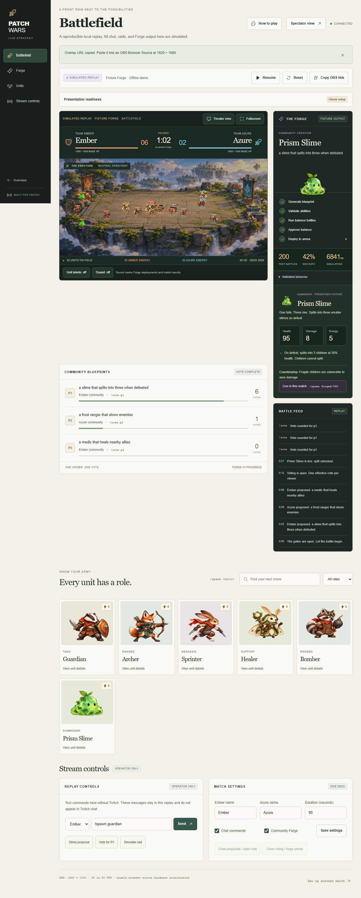

# PATCH WARS

**Two Communities. One Battlefield. Infinite Possibilities.**

A Twitch-controlled auto-battler where viewers propose new units, vote on their favorite, and watch a validated blueprint enter combat. Generated mechanics use a bounded ability language; no generated JavaScript is executed.



## Run it

Requires Node.js 24 and pnpm 10.11.0. No database, Docker, Twitch account or AI key is required for the local replay.

```sh
pnpm install
pnpm dev
```

Open **http://localhost:5173** and choose **Enter the demo**. The 90-second replay collects proposals, votes for the Prism Slime, runs 200 balance engagements in a worker, deploys the unit, triggers a simulated raid and finishes the battle. Pause, reset, inject commands or copy the OBS link from the control room. On Windows, use `pnpm.cmd` if PowerShell blocks the script.

Development operator controls also work on localhost when `WEB_ORIGIN` points to your tunnel. Keep one browser address throughout authorization and register its exact Twitch callback; see [local and tunnel setup](docs/setup.md#localhost-and-tunnel-access-together). Run `pnpm run doctor` before rehearsing to check local configuration without displaying secrets.

## Features

- Authoritative 20 Hz seeded combat, five starter classes, energy costs, base attacks, shields, slows, healing, splash and non-recursive splitting.
- React/PixiJS interface, voting, actual Forge lifecycle, behavior preview, results, mobile layout and reduced-motion support.
- Field Studio interface: ivory workspace, forest navigation, a dark battle stage and responsive operator forms.
- Theater view fills the browser window; Fullscreen uses the native browser API with a theater fallback. The whole battlefield stays visible without changing the match or restarting its canvas.
- Read-only spectators and transparent OBS overlay; sequenced snapshots and reconnect recovery.
- Twitch OAuth, server-only tokens, refresh/validation, EventSub recovery, source attribution and deduplication.
- One effective vote per stable viewer ID, deterministic ties and operator moderation.
- Fixture, free local Ollama, OpenAI Responses and guarded Codex SDK providers; worker validation and real balance simulation.
- Visible chat receipts, exact-unit spawn highlights, guided channel setup and direct Twitch chat links.
- Forge reveal cards with abilities, counterplay, stats and a three-second live deployment countdown.
- Optional unit labels, team rings and muted-by-default deployment/result sounds.
- Owned controls, origin checks, cooldowns, entity limits and generation quotas.
- Unit, adversarial, integration, browser and accelerated soak tests; CI and a production Dockerfile.

## Verification status

The local fixture replay is implemented and verified, including deployment and splitting. Actual measurements are in [evaluation](docs/evaluation/results.md), [browser metrics](docs/evaluation/browser.json) and [soak results](docs/evaluation/soak.json).

**Single-channel Twitch commands and real local AI generation have been verified.** Twitch receipts confirmed Archer and Guardian deployments in an authorized channel. Ollama generated a guardian that passed 200 balance engagements at a 42% win rate; see [local AI evidence](docs/evaluation/local-ai.json). Two-channel/Shared Chat behavior, a complete real-Twitch-to-AI recording, public hosting and submission still need verification. The demo is labelled simulated. The Codex runtime provider is gated off until OS-level isolation is verified. See [readiness](docs/readiness.md).

## Commands

| Command                                 | Purpose                                  |
| --------------------------------------- | ---------------------------------------- |
| `pnpm dev`                              | Build worker; start frontend and backend |
| `pnpm run doctor`                       | Secret-safe local configuration checks   |
| `pnpm typecheck`                        | Strict TypeScript checks                 |
| `pnpm lint`                             | ESLint                                   |
| `pnpm test`                             | Worker build and automated tests         |
| `pnpm exec playwright install chromium` | Install test browser                     |
| `pnpm test:e2e`                         | Browser, mobile and OBS checks           |
| `pnpm build`                            | Production bundles                       |
| `pnpm start`                            | Serve production build on port 3001      |
| `pnpm evaluate`                         | Reproduce fixture Forge metrics          |
| `pnpm soak`                             | Four accelerated simulation hours        |
| `pnpm audit --prod`                     | Dependency advisory check                |

For production-build testing locally, set `WEB_ORIGIN=http://localhost:3001` before `pnpm start`.

## Architecture

```text
Twitch EventSub → validate / deduplicate → commands / votes
                                                ↓
React / PixiJS ← read-only WebSocket ← authoritative game-core
                                                ↑
Proposal → Forge worker → schema / safety → balance → registration
```

Three apps and four shared packages form the pnpm workspace. Root dependencies and one lockfile simplify installation. Production serves frontend, OAuth and WebSockets from one origin.

## Twitch and OBS

Copy `.env.example` to `.env`, configure the Twitch application and operator key, then open `/dashboard`. Create a live match and authorize Ember. Invite the second broadcaster using a private expiring link. With one authorized channel, Azure remains the server-controlled opposing army. Native Shared Chat is labelled only after lifecycle events; separate channels are labelled separately.

OBS: use the copied overlay link at **1920 × 1080** with hardware acceleration. `/overlay/:id?transparent=1` is transparent; `/spectate/:id` is a full spectator page. Links grant viewing only.

For a single-channel stream, the app and OBS can run locally: viewers watch Twitch and type commands in the connected channel's chat. They do not need dashboard access or a Twitch extension. Follow the [complete demo and live OBS rehearsal](docs/manual-rehearsal.md). How to play explains commands; live matches show the next connection/start/chat action, while demo controls report simulated results inline.

Presentation readiness checks private setup without generating AI output. Lazy renderer loading, public asset caching, compact snapshots and offscreen rendering reduce unnecessary work; see [prioritized improvements](docs/priority-improvements.md) and run `pnpm run profile:ui` for local measurements.

## Free local AI

No OpenAI key is needed with Ollama. See [local AI setup and measured limitations](docs/local-ai.md). The verified development model is `qwen2.5:3b`; `pnpm verify:local-ai` exercises real generation, schema checks and balance. Local generation can take a minute: pause the match during generation, then resume once approved. Demo rooms always remain fixture-based.

## Codex contribution

This implementation was created in a real Codex thread. The genuine thread ID, commits and follow-up review prompts are in [Codex evidence](docs/codex-evidence.md). Fixture generation is not claimed as Codex execution.

## Documentation

[Architecture](docs/architecture.md) · [Setup](docs/setup.md) · [Twitch](docs/twitch-integration.md) · [Forge](docs/forge-pipeline.md) · [Security](docs/security.md) · [Testing](docs/testing.md) · [Deployment](docs/deployment.md) · [Competitive analysis](docs/competitive-analysis.md) · [Credits](docs/third-party-credits.md) · [Video storyboard](docs/demo-script.md) · [Devpost draft](docs/devpost-submission.md)

## Known limits

State and tokens are in memory: restart ends matches and requires Twitch reauthorization. Use one backend instance. There is no durable history/database. Balance uses a broad initial 25–75% win-rate gate and needs live-play tuning. Local moderation is conservative and English-oriented. Maximum-room CPU and bandwidth need deployment load testing. Optional monetization, polls, clips, Hype Train, leaderboards and arbitrary scripts are not implemented. No hosting or paid service was provisioned.

MIT licensed. Includes original generated arena/unit artwork and Phosphor UI icons; see [credits](docs/third-party-credits.md). Libraries retain their own licenses.

## UI redesign

The interface now uses a restrained navy/ivory/gold visual system, original matte unit artwork, readable Forge cards, a catalog-driven unit browser and accessible detail dialogs. All game rules, server endpoints, Twitch behavior and Forge validation remain unchanged. The detailed [implementation prompt](docs/ui-redesign-prompt.md), [design QA](design-qa.md) and [UI verification](docs/ui-redesign.md) record the scope and actual checks.
