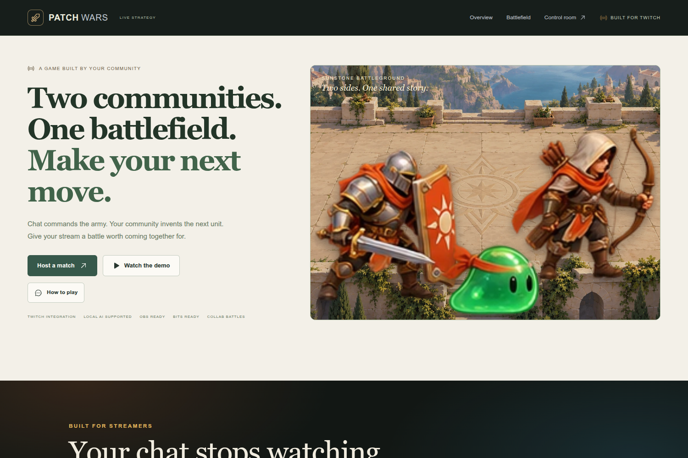
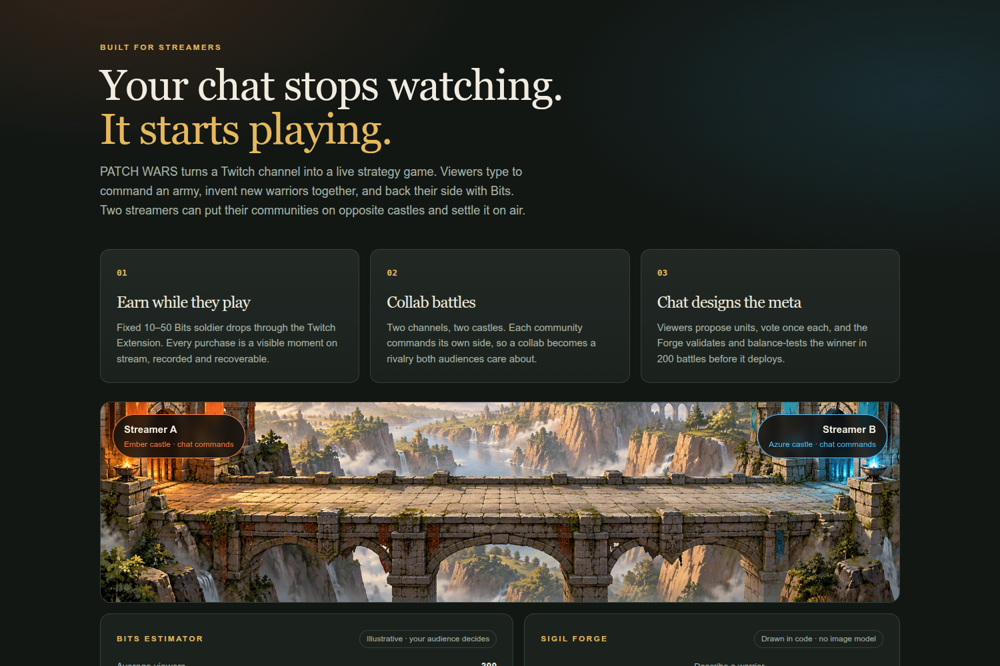
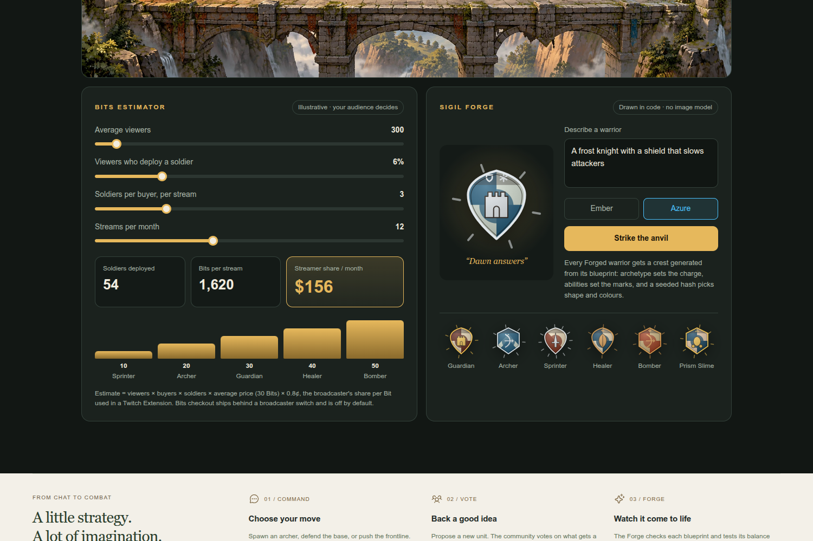
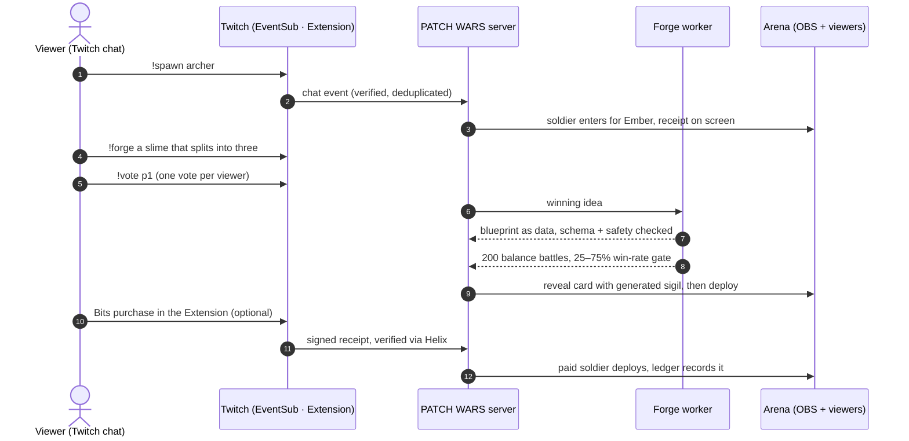
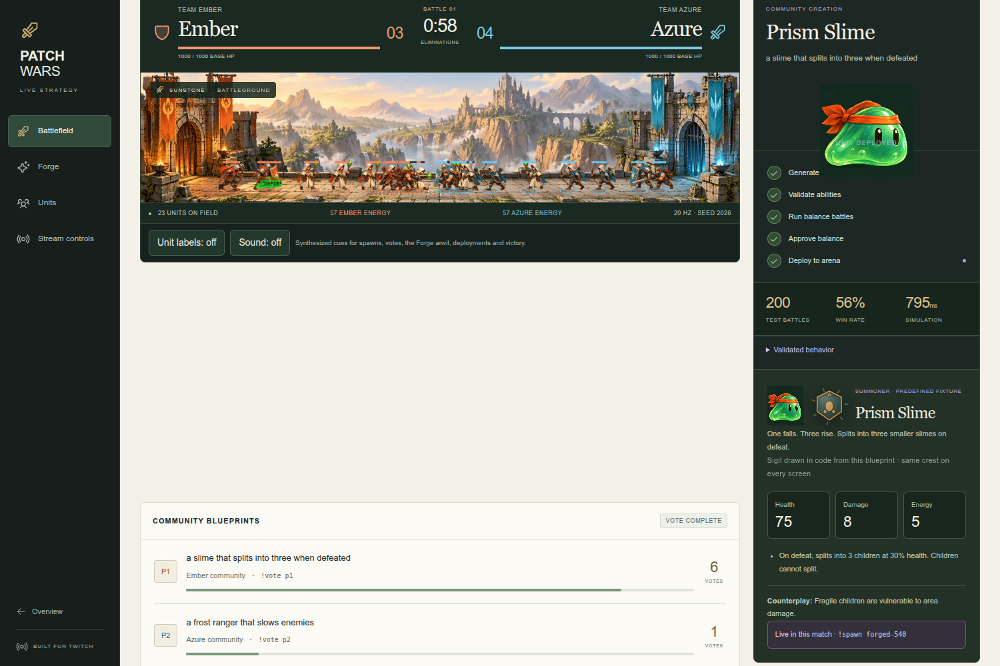
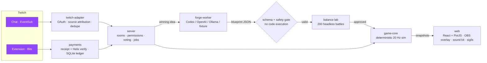
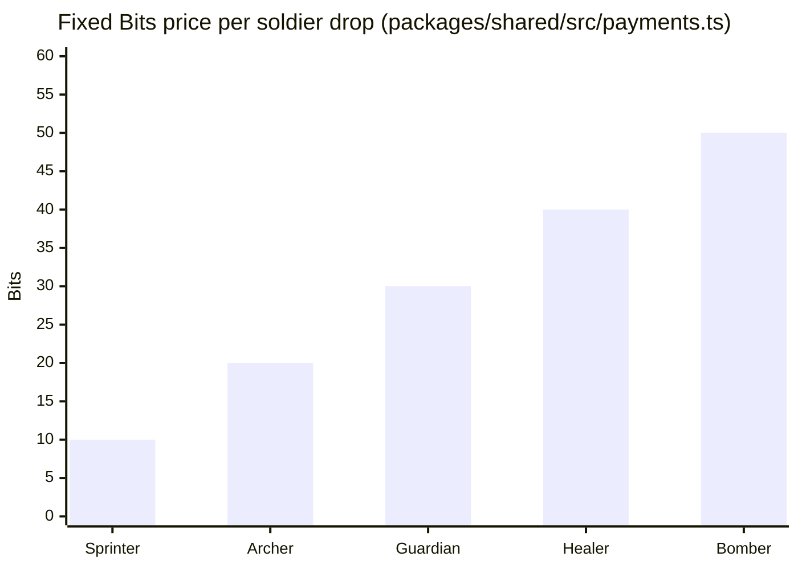

<div align="center">

# PATCH WARS

**Your chat stops watching. It starts playing.**

A live strategy game for Twitch: chat commands an army, invents new warriors, votes on them, and backs its side with Bits.
Two streamers can put their communities on opposite castles and settle it on air.

[](https://twitchcon-codex.devpost.com/)
[](docs/codex-evidence.md)
[](docs/testing.md)
[](tsconfig.json)
[](LICENSE)

`twitch` `eventsub` `twitch-extensions` `bits` `obs` `auto-battler` `react` `pixijs` `fastify` `zod` `openai-codex` `ollama` `web-audio`

**[Watch the 2:46 demo film](https://www.youtube.com/watch?v=2WlwBF28-nU)** · [Run it locally](#run-it-in-two-minutes) · [How streamers use it](#how-streamers-use-it) · [Architecture](#architecture) · [Proof](#proof-in-numbers) · [Demo film](#demo-film) · [Submission copy](docs/SUBMISSION.md)



</div>

## Why it exists

A Twitch chat is full of people who care, and almost nothing they type changes what happens on stream. Streamers have
the same few levers: alerts, polls, a donation box. PATCH WARS gives chat real control of a game the whole stream is
watching, and gives the streamer a new reason for viewers to stay, play and spend.

| For viewers                                                   | For streamers                                                         | For collabs                                                   |
| ------------------------------------------------------------- | --------------------------------------------------------------------- | ------------------------------------------------------------- |
| Type `!spawn archer` and a soldier marches out for your side. | Fixed 10–50 Bits soldier drops through a Twitch Extension.            | Two channels, two castles. Each chat holds its own side.      |
| Propose a new warrior with `!forge`, vote once with `!vote`.  | Every purchase is a visible on-stream moment, logged and recoverable. | A shared screen becomes a rivalry both audiences show up for. |
| Watch your idea get its own crest and enter the fight.        | OBS overlay, moderation, pause and rematch from one control room.     | Raids and Shared Chat are attributed to the right community.  |



## What's new in this pass

- **For streamers section** on the landing page, with three pillars (earn, collab, chat designs the meta) and a
  **Bits estimator**: viewers × buyers × soldiers × the fixed soldier prices × the broadcaster's 0.8¢ share per Bit used
  in an Extension. It is labelled as an illustration; Bits checkout ships behind a broadcaster switch and is off by default.
- **Forge sigils**: every warrior gets an original crest **drawn in code from its blueprint** (archetype sets the charge,
  abilities set the marks, a seeded FNV-1a/mulberry32 hash picks the shape and colours). No image model, no generated
  markup; the same crest renders on every screen. Shown on Forge reveal cards, roster cards, unit details and in a live **Sigil Forge** on the landing page.
- **Synthesized sound kit** (Web Audio, no audio files): spawn, vote, Forge anvil, reveal arpeggio, deployment horn,
  victory fanfare. Opt-in with the existing Sound toggle, throttled for busy chats.



## How streamers use it



1. **Host:** open `/dashboard`, create a live match, authorize your channel. Add the overlay to OBS as a browser source
   (1920 × 1080). Optional: invite a second broadcaster with a private expiring link for a collab battle.
2. **Viewers:** type in your normal Twitch chat. No sign-up, no extension required for commands.
3. **Earn (optional):** install the PATCH WARS Twitch Extension and enable paid deployments. Viewers pick a soldier,
   pay 10–50 Bits, and the server only spawns it after verifying the transaction.

| Command               | What it does                                                                        |
| --------------------- | ----------------------------------------------------------------------------------- |
| `!spawn <unit>`       | Deploys a guardian, archer, sprinter, healer, bomber or a Forged unit for your side |
| `!attack` / `!defend` | Changes your army's stance                                                          |
| `!join`               | Joins a side (`!units`, `!score` and `!help` show state)                            |
| `!forge <idea>`       | Proposes a new warrior (bounded length, filtered)                                   |
| `!vote <id>`          | One effective vote per viewer per round                                             |



## Run it in two minutes

Requires Node.js 24 and pnpm 10.11.0. No database, Docker, Twitch account or AI key is needed for the local replay.

```sh
pnpm install
pnpm dev
```

Open **http://localhost:5173** and choose **Watch the demo**. The 90-second replay collects proposals, votes for the
Prism Slime, runs 200 balance engagements in a worker, deploys it with its sigil, triggers a simulated raid and finishes
the battle. All simulated chat and fixture Forge output is labelled in the UI. `/stream-demo` previews the streaming layout.

For a real channel: copy `.env.example` to `.env`, add your Twitch application, then follow [setup](docs/setup.md) and the
[OBS rehearsal](docs/manual-rehearsal.md). `pnpm run doctor` checks configuration without printing secrets.

## Architecture



| Package                   | Responsibility                                                                                       |
| ------------------------- | ---------------------------------------------------------------------------------------------------- |
| `packages/shared`         | Strict Zod boundary schemas and wire contracts                                                       |
| `packages/game-core`      | Deterministic 20 Hz simulation and bounded ability interpreter; no IO, clocks or unseeded randomness |
| `packages/twitch-adapter` | OAuth, EventSub, source attribution and deduplication                                                |
| `apps/forge-worker`       | Provider adapters, safety checks and headless balance simulations                                    |
| `apps/server`             | Authoritative rooms, permissions, voting, Forge jobs, Bits fulfilment, snapshots                     |
| `apps/web`                | React control room, PixiJS arena, streamer landing, sigils and sound kit                             |
| `apps/extension`          | Twitch video-overlay Extension with Bits soldier products                                            |

Generated mechanics are **data in a bounded ability language** (`shield`, `slow`, `split`, `heal`, `splash`, with hard
numeric limits). No generated JavaScript is ever executed. See [Forge pipeline](docs/forge-pipeline.md) and [security](docs/security.md).

## Proof in numbers

All numbers come from files in this repository; run `pnpm evaluate`, `pnpm soak` and `pnpm test` to reproduce them.

| Measure                            | Result                                       | Source                                         |
| ---------------------------------- | -------------------------------------------- | ---------------------------------------------- |
| Automated tests                    | 166 passing across 32 files                  | `pnpm test`                                    |
| Adversarial Forge prompts rejected | 30 / 30                                      | [results.md](docs/evaluation/results.md)       |
| Duplicate chat events suppressed   | 1000 / 1000                                  | [results.md](docs/evaluation/results.md)       |
| Balance check per new unit         | 200 cost-matched engagements, 25–75% gate    | [results.md](docs/evaluation/results.md)       |
| Simulation throughput              | 64,379 ticks / s (3,600 ticks in 55.9 ms)    | [results.md](docs/evaluation/results.md)       |
| Accelerated soak                   | 4 simulated hours, 288,000 ticks, 0 failures | [soak.json](docs/evaluation/soak.json)         |
| Local AI (Ollama `qwen2.5:3b`)     | generated guardian passed at 42% win rate    | [local-ai.json](docs/evaluation/local-ai.json) |
| Browser frame interval             | 16.7 ms mean, 16.8 ms p95                    | [browser.json](docs/evaluation/browser.json)   |



## Verification status

**Verified:** single-channel Twitch chat commands with receipts in an authorized channel; the embedded Twitch player and
chat inside a real match; local Ollama generation through schema and balance gates; the full fixture replay.

**Implemented, still needs live acceptance:** Bits purchases (the Extension is not yet Twitch-approved; charging is off
by default), two-channel Shared Chat, real raid events, public hosting. The Codex SDK runtime provider is gated off until
OS-level isolation is verified. See [readiness](docs/readiness.md).

## Built with Codex

The engine, Twitch integration, Forge, server, Extension, tests and art pipeline were built in one Codex thread
(`01a18312-00c1-7360-91d0-27e410da449c`) across 69 commits. Milestones, review prompts and what Codex caught are in
[Codex evidence](docs/codex-evidence.md). A final UI, sound, sigil and documentation polish pass used Claude Code.

## Demo film

[](https://www.youtube.com/watch?v=2WlwBF28-nU)

The film is reproducible from code in [`video/`](video/): narration as data, numbers read from the repo (`facts.py`),
screen flows recorded from the real app (`record.mjs`), drawn scenes (`graphics.html`, 3D `three.html`), music composed
in code (`music.py`) and assembled by `build.py`.

## Commands

| Command                        | Purpose                                             |
| ------------------------------ | --------------------------------------------------- |
| `pnpm dev`                     | Build worker; start frontend and backend            |
| `pnpm run doctor`              | Secret-safe local configuration checks              |
| `pnpm typecheck` / `pnpm lint` | Strict TypeScript and ESLint                        |
| `pnpm test` / `pnpm test:e2e`  | Unit, integration and browser tests                 |
| `pnpm build` / `pnpm start`    | Production build served on port 3001                |
| `pnpm evaluate` / `pnpm soak`  | Forge metrics and four accelerated simulation hours |
| `pnpm build:extension`         | Twitch Extension upload assets                      |

## Documentation

[Architecture](docs/architecture.md) · [Setup](docs/setup.md) · [Twitch](docs/twitch-integration.md) ·
[Live view and Extension](docs/live-experience.md) · [Paid deployments](docs/paid-deployments.md) ·
[Forge](docs/forge-pipeline.md) · [Security](docs/security.md) · [Testing](docs/testing.md) ·
[Deployment](docs/deployment.md) · [Credits](docs/third-party-credits.md) · [Submission copy](docs/SUBMISSION.md)

## Known limits

State and tokens are in memory, so a restart ends matches and requires reauthorization. Use one backend instance. Balance
uses a broad initial 25–75% gate and needs live-play tuning. Local moderation is conservative and English-oriented. The
earnings estimator is an illustration, not a forecast.

MIT licensed. Original generated arena and unit artwork, Phosphor icons; see [credits](docs/third-party-credits.md).
