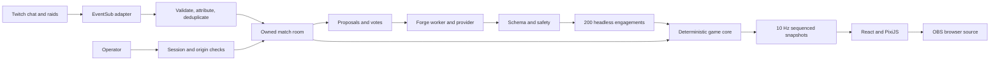

# Architecture

A single authoritative Node service owns matches and serves the production frontend. Isolated Forge workers keep simulation work away from the event loop.

| Package        | Responsibility                                             |
| -------------- | ---------------------------------------------------------- |
| shared         | Strict schemas, unit/team models, snapshot contracts       |
| game-core      | Seeded RNG, 20 Hz steps, abilities, combat, win conditions |
| twitch-adapter | OAuth, Helix, EventSub, normalization                      |
| test-fixtures  | Concepts, adversarial inputs and event fixtures            |
| forge-worker   | Providers, moderation, validation, balancing               |
| server         | Sessions, rooms, voting, quotas, snapshots                 |
| web            | Landing, demo, operator, spectator and overlay             |

Game-core has no IO or clocks. The same seed, tick-indexed inputs and blueprints reproduce the same result. Stable entity IDs and alternating update order avoid always favoring the first side. Units target the nearest living enemy, otherwise the opposing base. Timeouts compare base HP, then eliminations, then draw.

Limits: 30 rooms, four per session, 100 spectators per room, 160 entities, six proposals per round and 20,000 participants/voters. These are protective ceilings, not a benchmark of simultaneous capacity. Snapshots run at 10 Hz and PixiJS interpolates. Slow consumers with over 1 MB buffered output reconnect to a fresh snapshot.

Each room permits one worker, a 128 MB JS heap and a parent-side timeout. Worker threads isolate resource usage, not arbitrary hostile executable code. Generated content is data; the Codex subprocess path needs separate OS isolation and is gated off.

All state is in memory. Client reconnect recovers snapshots. Twitch reconnect restores subscriptions, not missing events. Server restart loses rooms and tokens. Deploy between matches. Durable history and multiple replicas are future work.

Combined internal voting avoids native poll eligibility. Plain CSS replaces optional Tailwind. Geometric art avoids third-party assets. No Redis, database, cloud builder or external task tracker is needed for the local application.
